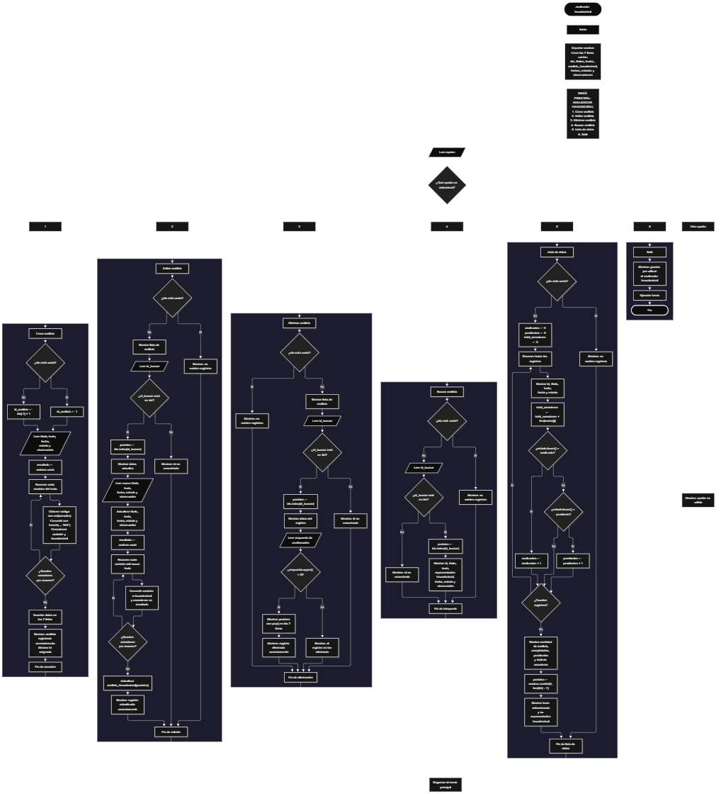

Este proyecto, llamado <b>analizador hexadecimal</b>, fue desarrollado en <b>python</b> como un ejercicio práctico para fortalecer la lógica de programación mediante la creación de un sistema de análisis de textos desde la consola. El programa cuenta con un menú principal de seis opciones que permite <b>crear, editar, eliminar, buscar y listar análisis</b>, además de finalizar la ejecución. Cada análisis almacena datos como el título, el texto original, su representación hexadecimal, la fecha, el estado y las observaciones, utilizando siete listas paralelas para organizar la información durante la ejecución. Durante su desarrollo se aplicaron conceptos fundamentales de programación, como variables, listas, estructuras condicionales, ciclos repetitivos y conversión de caracteres, además de procesos para buscar, modificar, eliminar y consultar registros. Este proyecto permite poner en práctica los conocimientos adquiridos en Python y sirve como base para desarrollar sistemas de análisis y gestión de información más avanzados utilizando otros lenguajes y tecnologías.

<h2 align="center">⚙️ Funcionamiento del menú principal</h2>

### ➕ Crear análisis

La opción <b>1) crear análisis</b> permite registrar un nuevo texto para convertir sus caracteres a hexadecimal. Antes de realizar el registro, el sistema genera un identificador automático mediante la variable <b>id_analisis</b>. Si no existen registros, el identificador comienza en <b>1</b>; en caso contrario, utiliza el último identificador almacenado más uno, mediante la expresión <b>ids[-1] + 1</b>. Después, el programa solicita el <b>título, texto, fecha, estado y observación</b> del análisis. Para obtener la representación hexadecimal, inicializa la variable <b>resultado</b> como una cadena vacía y utiliza un ciclo <b>for</b> para recorrer cada carácter del texto. En cada repetición, emplea la función <b>ord()</b> para obtener el código numérico del carácter y la función <b>format()</b> con el formato <b>"02X"</b> para representarlo en hexadecimal, utilizando letras mayúsculas y un mínimo de dos dígitos. El carácter original y su representación se concatenan en la variable <b>resultado</b>. Finalmente, los datos se almacenan en sus respectivas listas y se muestran los mensajes <b>"análisis registrado correctamente."</b> y el identificador asignado.

### ✏️ Editar análisis

La opción <b>2) editar análisis</b> permite modificar la información de un análisis registrado. Primero, el programa comprueba si existen registros mediante la condición <b>len(ids) == 0</b>. Si las listas están vacías, muestra el mensaje <b>"no existen registros."</b>. En caso contrario, presenta una lista con el identificador, título, texto, fecha, estado y observación de cada registro. Después, solicita el identificador que se desea editar y comprueba si existe dentro de la lista <b>ids</b>. Si lo encuentra, utiliza el método <b>index()</b> para obtener la posición correspondiente y muestra los datos actuales. A continuación, solicita el nuevo título, texto, fecha, estado y observación, actualizando los valores de las listas correspondientes. Como el texto puede cambiar, el programa vuelve a generar su representación hexadecimal recorriendo cada carácter mediante un ciclo <b>for</b> y utilizando las funciones <b>ord()</b> y <b>format()</b>. El resultado actualizado se almacena en <b>analisis_hexadecimal</b> en la misma posición del registro. Finalmente, presenta el mensaje <b>"registro actualizado correctamente."</b>. Si el identificador no existe, muestra el mensaje <b>"id no encontrada."</b>.

### 🗑️ Eliminar análisis

La opción <b>3) eliminar análisis</b> permite eliminar un registro mediante su identificador. Antes de comenzar, el programa comprueba si existen análisis almacenados. Si las listas están vacías, muestra el mensaje <b>"no existen registros."</b>. Si hay registros disponibles, presenta una lista con el identificador, título, texto, fecha, estado y observación de cada análisis. Después, solicita el identificador que se desea eliminar y comprueba si se encuentra en la lista <b>ids</b>. Si existe, utiliza el método <b>index()</b> para localizar su posición, muestra los datos correspondientes y solicita confirmación mediante la pregunta <b>"¿desea eliminar este registro? (s/n):"</b>. La respuesta se convierte a mayúsculas con el método <b>upper()</b> y, si corresponde a <b>"S"</b>, el programa elimina los datos de esa posición mediante el método <b>pop()</b> en las siete listas: <b>ids, titulos, textos, analisis_hexadecimal, fechas, estados y observaciones</b>. De esta manera, los datos relacionados con el registro se eliminan de forma coordinada. Finalmente, muestra el mensaje <b>"registro eliminado correctamente."</b>. Si el usuario no confirma la eliminación, presenta el mensaje <b>"el registro no fue eliminado."</b>. Si el identificador no existe, muestra el mensaje <b>"id no encontrada."</b>.

### 🔎 Buscar análisis

La opción <b>4) buscar análisis</b> permite localizar un registro mediante su identificador. Primero, el programa comprueba si existen análisis almacenados. Si no hay registros, muestra el mensaje <b>"no existen registros."</b>. En caso contrario, solicita el identificador que se desea buscar y comprueba si está presente en la lista <b>ids</b>. Cuando encuentra una coincidencia, utiliza el método <b>index()</b> para obtener la posición del registro y mostrar su información completa: <b>id, título, texto, representación hexadecimal, fecha, estado y observación</b>. La representación hexadecimal se recupera de la lista <b>analisis_hexadecimal</b>, por lo que no es necesario realizar nuevamente la conversión durante la búsqueda. Si el identificador introducido no corresponde a un registro almacenado, el programa muestra el mensaje <b>"id no encontrada."</b>. Esta función facilita consultar la información de un análisis específico sin necesidad de recorrer manualmente todos sus datos.

### 📋 Lista de datos

La opción <b>5) lista de datos</b> permite visualizar los análisis registrados y consultar estadísticas generales del programa. Primero, comprueba si existen registros. Si las listas están vacías, muestra el mensaje <b>"no existen registros."</b>. En caso contrario, inicializa las variables <b>analizados, pendientes y total_caracteres</b> en cero. Después, utiliza un ciclo <b>for</b> para recorrer los registros y mostrar el identificador, título, texto, fecha y estado de cada análisis. Durante el recorrido, la función <b>len()</b> permite calcular la cantidad de caracteres de cada texto, cuyo resultado se acumula en la variable <b>total_caracteres</b>. Asimismo, el programa comprueba el estado de cada registro utilizando el método <b>lower()</b>: si el estado coincide con <b>"analizado"</b>, aumenta el contador <b>analizados</b>; si coincide con <b>"pendiente"</b>, aumenta el contador <b>pendientes</b>. Al finalizar el recorrido, muestra las estadísticas, que incluyen la cantidad total de análisis, los análisis completados, los análisis pendientes y el total de caracteres analizados. Finalmente, utiliza la función <b>random.randint(0, len(ids) - 1)</b> para seleccionar aleatoriamente una posición de las listas y mostrar el texto seleccionado junto con su representación hexadecimal almacenada. Esta opción permite consultar tanto el resumen de los registros como un análisis elegido al azar.

### 🚪 Salir del menú principal

La opción <b>6) salir</b> está destinada a finalizar la ejecución del programa y muestra el mensaje <b>"gracias por utilizar el analizador hexadecimal."</b>. El menú principal se encuentra dentro de una estructura repetitiva <b>while True</b>, que mantiene el programa en funcionamiento para que el usuario pueda seleccionar las diferentes operaciones disponibles. Cuando se selecciona la opción <b>"6"</b>, el programa muestra el mensaje de despedida y utiliza la instrucción <b>break</b> para interrumpir el ciclo y finalizar el menú principal. Si el usuario introduce un valor que no coincide con ninguna de las opciones definidas, el programa muestra el mensaje <b>"opción no válida."</b> y vuelve a solicitar una opción.

<h2 align="center">🧠 Temas aplicados en el proyecto</h2>

### 📦 Variables

En este proyecto se utilizan variables para almacenar los datos introducidos por el usuario, controlar la opción seleccionada en el menú, generar identificadores, localizar registros, construir las representaciones hexadecimales y calcular las estadísticas. Cada variable cumple una función específica dentro de las operaciones del sistema, permitiendo procesar los textos y administrar los análisis registrados de manera organizada.

🔢 **opcion:** Almacena la opción seleccionada por el usuario en el menú principal.

🆔 **id_analisis:** Almacena el identificador que se asigna al crear un nuevo análisis.

🔎 **id_buscar:** Almacena el identificador introducido por el usuario para localizar un registro.

📍 **posicion:** Permite acceder a la posición correspondiente a un registro dentro de las listas.

📝 **titulo:** Almacena el título del análisis que se está registrando o modificando.

🔤 **texto:** Almacena el texto introducido durante la creación de un análisis.

🔄 **resultado:** Construye la representación hexadecimal de los caracteres del texto.

📊 **analizados y pendientes:** Almacenan las cantidades de análisis que tienen los estados correspondientes.

🔢 **total_caracteres:** Acumula la cantidad de caracteres presentes en los textos registrados.

### 🗃️ Listas

En este proyecto se utilizan siete listas paralelas para almacenar los datos relacionados con cada análisis. Todas las listas utilizan la misma posición para representar la información de un mismo registro. Por ejemplo, los datos del análisis almacenado en la posición <b>0</b> se encuentran distribuidos entre <b>ids[0], titulos[0], textos[0], analisis_hexadecimal[0], fechas[0], estados[0] y observaciones[0]</b>. Esta organización permite recorrer, buscar, modificar, mostrar y eliminar los registros manteniendo relacionados sus respectivos datos. Las listas se crean vacías al inicio del programa y almacenan información durante la ejecución.

🆔 **ids:** Almacena los identificadores de los análisis registrados.

📝 **titulos:** Almacena los títulos de los análisis.

🔤 **textos:** Guarda los textos originales que se desean convertir a hexadecimal.

🔢 **analisis_hexadecimal:** Almacena las representaciones hexadecimales generadas a partir de los caracteres de cada texto.

📅 **fechas:** Almacena las fechas asociadas a los registros.

📌 **estados:** Guarda el estado de cada análisis, como analizado o pendiente.

📄 **observaciones:** Almacena las observaciones correspondientes a cada registro.

### 🔀 Estructuras condicionales

En este proyecto se utilizan las estructuras <b>if, elif y else</b> para controlar las opciones del menú principal, comprobar si existen registros antes de ejecutar determinadas operaciones, verificar si un identificador está almacenado y determinar si el usuario confirma una eliminación. También se emplean condiciones para clasificar los registros según su estado y para comprobar si el texto contiene el separador decimal utilizado por la conversión a hexadecimal, cuando corresponde al procesamiento de caracteres. Estas condiciones permiten que el programa ejecute instrucciones diferentes según la opción seleccionada, la existencia de los registros y los datos introducidos por el usuario.

### 🔄 Estructuras repetitivas

En este proyecto se utilizan los ciclos <b>while</b> y <b>for</b>. El ciclo <b>while True</b> mantiene activo el menú principal hasta que el usuario selecciona la opción de salida, momento en el que se ejecuta la instrucción <b>break</b>. Los ciclos <b>for</b> permiten recorrer las listas para mostrar los registros y recorrer cada carácter de un texto durante la conversión hexadecimal. Estos ciclos también se utilizan cuando se vuelve a generar la representación hexadecimal después de editar un análisis. De esta manera, las estructuras repetitivas permiten procesar varios registros y caracteres sin tener que escribir instrucciones independientes para cada elemento.

### 🎯 Estructura de selección

El programa evalúa el valor almacenado en la variable <b>opcion</b> mediante una estructura condicional compuesta por <b>if, elif y else</b>. Cada caso representa una operación específica del sistema: <b>crear, editar, eliminar, buscar, listar datos o salir</b>. También se utiliza el bloque <b>else</b> para mostrar el mensaje <b>"opción no válida."</b> cuando el valor introducido no coincide con ninguna de las opciones definidas. Esta organización permite mantener las operaciones separadas y facilitar la comprensión del menú principal.

### 🔢 Conversión de caracteres a hexadecimal

La conversión hexadecimal constituye la función principal de este proyecto. Para realizarla, el programa recorre cada carácter del texto mediante un ciclo <b>for</b> y utiliza la función <b>ord()</b> para obtener el valor numérico correspondiente a cada carácter. Después, utiliza la función <b>format()</b> con el formato <b>"02X"</b> para convertir ese valor a una representación hexadecimal en mayúsculas, con un mínimo de dos dígitos. La instrucción <b>resultado += caracter + " = " + format(ord(caracter), "02X") + " "</b> concatena el carácter original con su representación hexadecimal. El resultado se almacena en la lista <b>analisis_hexadecimal</b> y puede consultarse posteriormente. Por ejemplo, el texto <b>"Hola"</b> produce una representación similar a <b>"H = 48 o = 6F l = 6C a = 61"</b>. Esta operación se ejecuta tanto al crear un análisis como al editar su texto, garantizando que el resultado almacenado corresponda al contenido actual del registro.

### 🔍 Búsqueda y actualización de registros

El programa utiliza el método <b>index()</b> para localizar la posición de un identificador dentro de la lista <b>ids</b>. Antes de utilizarlo, comprueba que el identificador exista mediante la condición <b>id_buscar in ids</b>. Una vez localizada la posición, el programa puede consultar los datos asociados en las demás listas o actualizar la información correspondiente. Este procedimiento se utiliza en las operaciones de edición, eliminación y búsqueda. Al trabajar con listas paralelas, es importante mantener la misma posición para los datos de cada registro, de modo que el título, el texto, su representación hexadecimal, la fecha, el estado y la observación continúen relacionados.

### 🎲 Selección aleatoria

El proyecto utiliza el módulo <b>random</b> para seleccionar aleatoriamente uno de los análisis registrados durante la opción de lista de datos. La instrucción <b>random.randint(0, len(ids) - 1)</b> genera un número entero comprendido entre cero y el índice de la última posición ocupada. El valor obtenido se almacena en la variable <b>posicion</b> y se utiliza para consultar el texto y su representación hexadecimal en las listas correspondientes. Esta selección se realiza únicamente cuando existen registros, debido a la comprobación previa que impide continuar con la operación si las listas están vacías.

<h2 align="center">¿Cómo se implementaron las operaciones crud en el proyecto?</h2>

Las operaciones <b>crud</b> se implementaron mediante las opciones del menú principal, permitiendo administrar los análisis registrados. La operación <b>crear</b> corresponde a <b>crear análisis</b>, donde se introducen los datos de un nuevo registro y se genera su representación hexadecimal; <b>leer</b> se realiza mediante las opciones <b>buscar análisis y lista de datos</b>, que permiten consultar la información individual y las estadísticas generales; <b>actualizar</b> corresponde a <b>editar análisis</b>, donde se modifican los datos de un registro y se recalcula su representación hexadecimal cuando cambia el texto; y <b>eliminar</b> se realiza mediante la opción <b>eliminar análisis</b>, que retira los datos de las siete listas después de la confirmación del usuario. Estas operaciones utilizan variables, listas, condicionales y ciclos para gestionar la información almacenada temporalmente durante la ejecución del programa.

<h2 align="center">Diagrama de flujo del proyecto</h2>

<h2 align="center">🛡️ Validaciones del programa</h2>

### 📭 No existen registros

Esta comprobación se utiliza en las opciones de <b>editar, eliminar, buscar y lista de datos</b>. El programa verifica si la lista <b>ids</b> está vacía mediante la condición <b>len(ids) == 0</b>. Si no existen registros almacenados, muestra el mensaje <b>"no existen registros."</b> y evita continuar con operaciones que necesitan información previamente registrada. Esta comprobación también impide realizar la selección aleatoria cuando no hay análisis disponibles.

### ❌ Identificador no encontrado

Esta comprobación se utiliza en las opciones de <b>editar, eliminar y buscar análisis</b>. El programa solicita el identificador del registro y comprueba si está presente en la lista <b>ids</b> mediante la condición <b>id_buscar in ids</b>. Si el identificador existe, utiliza el método <b>index()</b> para obtener la posición correspondiente y continuar con la operación seleccionada. Si no se encuentra, muestra el mensaje <b>"id no encontrada."</b>. Esta comprobación evita intentar acceder a un registro mediante un identificador que no está almacenado.

### ⚠️ Confirmación de eliminación

Esta validación se utiliza durante la opción de <b>eliminar análisis</b>. Después de localizar el registro y mostrar sus datos, el programa solicita al usuario que confirme si desea eliminarlo. La respuesta se procesa mediante el método <b>upper()</b>, por lo que tanto la letra <b>"S"</b> como la letra <b>"s"</b> permiten confirmar la operación. Si la respuesta coincide con <b>"S"</b>, los datos se eliminan de las siete listas mediante <b>pop()</b>. En caso contrario, el programa muestra el mensaje <b>"el registro no fue eliminado."</b> y conserva el registro almacenado.

### ⚠️ Opción inválida

La estructura condicional del menú incluye un bloque <b>else</b> que muestra el mensaje <b>"opción no válida."</b> cuando el usuario introduce una opción diferente de <b>1, 2, 3, 4, 5 o 6</b>. Después de mostrar el mensaje, el ciclo <b>while True</b> continúa ejecutándose y vuelve a presentar el menú principal. Esta comprobación permite mantener el funcionamiento del programa cuando se introduce una opción que no está contemplada.

### 🔢 Entrada de identificadores

En las operaciones de edición, eliminación y búsqueda, el programa convierte el identificador introducido por el usuario a un número entero mediante la función <b>int()</b>. Sin embargo, el código actual no incluye un manejo de errores para entradas que no puedan convertirse a un número entero. Si el usuario introduce letras u otro valor incompatible, el programa puede generar una excepción y detener su ejecución. Por lo tanto, la comprobación de existencia del identificador funciona cuando la entrada se ha convertido correctamente a un entero, pero no constituye una validación completa del formato de entrada.

### 📌 Control de estados

Durante la opción de lista de datos, el programa compara el estado de cada registro después de convertirlo a minúsculas mediante el método <b>lower()</b>. Si el resultado coincide con <b>"analizado"</b>, incrementa el contador de análisis completados; si coincide con <b>"pendiente"</b>, incrementa el contador de análisis pendientes. Aunque al registrar un análisis se solicita uno de estos dos estados, el código actual no impide introducir otros valores. Por esta razón, los registros con estados diferentes de los dos previstos se muestran en la lista, pero no se contabilizan dentro de esas categorías estadísticas.

<h2 align="center">🎯 Objetivo del proyecto</h2>

El objetivo principal de este proyecto es fortalecer la <b>lógica de programación</b> mediante el desarrollo de un sistema de análisis hexadecimal en <b>python</b>. A través de su construcción se busca aplicar los conocimientos adquiridos sobre variables, listas, estructuras condicionales, ciclos repetitivos, cadenas de texto y conversión de caracteres, integrándolos para resolver un problema de manera organizada. Además, el proyecto permite comprender cómo registrar, consultar, modificar y eliminar información en una aplicación de consola, así como generar representaciones hexadecimales y calcular estadísticas a partir de los datos almacenados. De esta manera, se establece una base para desarrollar sistemas de análisis y gestión más completos con otros lenguajes y tecnologías.

